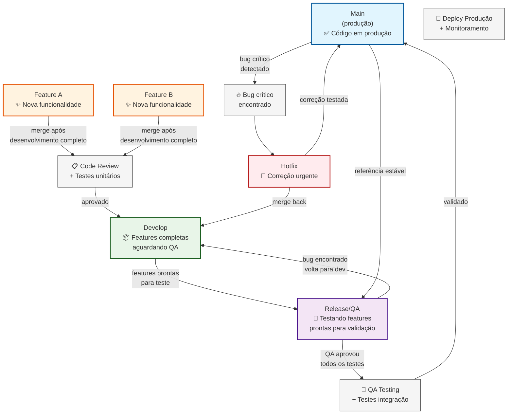

# Fluxo Git Melhorado - Evitando Features Não Testadas em Produção

## Problema Identificado
- Features completas mas não testadas pelo QA podem ir direto para produção
- Necessidade de um processo que garanta que apenas código validado pelo QA seja liberado

## Solução Proposta



## Fluxo Detalhado

### 🎯 **Branches Principais**

1. **Main (Produção)**
   - ✅ Apenas código aprovado pelo QA
   - 🏷️ Sempre taggeado com versões
   - 🚀 Deploy automático para produção

2. **Release/QA** 
   - 🧪 Ambiente dedicado para testes do QA
   - 📦 Features completas aguardando validação
   - 🔒 **BARREIRA**: Nada vai para Main sem passar aqui

3. **Develop**
   - 🔧 Features completas pelos desenvolvedores
   - ✅ Code review aprovado
   - ⏳ Aguardando ser movido para QA

### 🔄 **Processo de Release**

```
┌─────────────────┐    ┌─────────────────┐    ┌─────────────────┐
│   Develop       │───▶│   Release/QA    │───▶│      Main       │
│                 │    │                 │    │                 │
│ Features prontas│    │ QA testando     │    │ Produção estável│
│ Code review ✅  │    │ Bugs corrigidos │    │ Deploy ✅       │
└─────────────────┘    └─────────────────┘    └─────────────────┘
```

### 🛡️ **Proteções Implementadas**

1. **Gate QA**: Features só vão para produção após validação completa
2. **Branch Protection**: Main protegido, apenas merges da Release/QA
3. **Ambiente Isolado**: QA testa em ambiente dedicado
4. **Rollback Rápido**: Main sempre estável para rollback

### 🚨 **Fluxo de Hotfix**

```
Main ──┐
       │ (bug crítico detectado)
       ▼
    Hotfix ──┬──▶ Main (correção urgente)
             └──▶ Develop (sync para próximas releases)
```

## Benefícios da Solução

✅ **Elimina risco**: Features não testadas nunca chegam à produção  
✅ **QA dedicado**: Ambiente exclusivo para validação  
✅ **Desenvolvimento contínuo**: Dev não para durante QA  
✅ **Rastreabilidade**: Histórico claro do que foi testado  
✅ **Rollback seguro**: Main sempre representa produção estável  

## Comandos Git

### Movendo features para QA
```bash
# Criar branch de release para QA
git checkout develop
git checkout -b release/v1.2.0
git push -u origin release/v1.2.0
```

### Deploy para produção (apenas após QA)
```bash
# Merge para main após aprovação QA
git checkout main
git merge --no-ff release/v1.2.0
git tag -a v1.2.0 -m "Release aprovada pelo QA"
git push origin main --tags
```

### Correção encontrada no QA
```bash
# Fix na própria branch de release
git checkout release/v1.2.0
# fazer correção
git commit -m "Fix: correção encontrada no QA"
# Re-testar até aprovação final
```